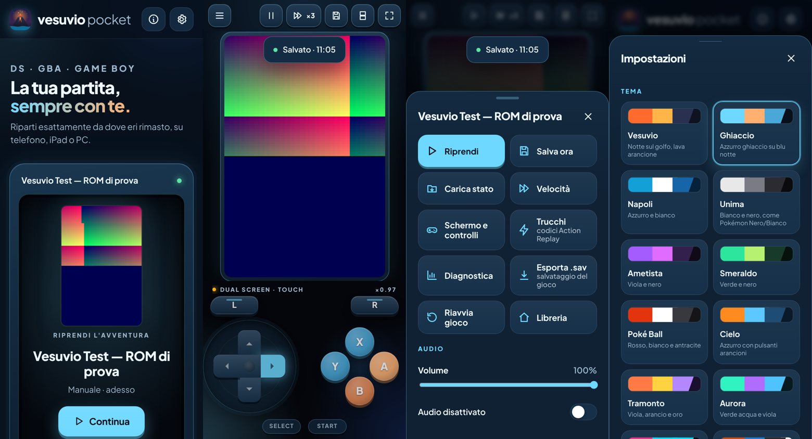
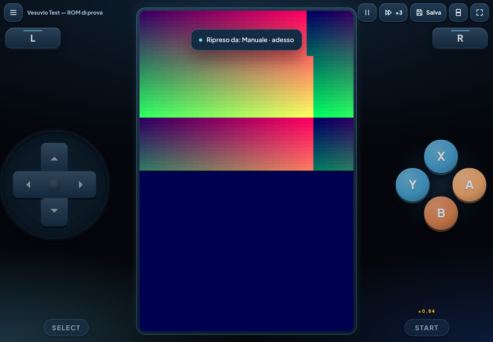

# Vesuvio 🌋

Emulatore **Nintendo DS**, **Game Boy Advance**, **Game Boy** e **Game Boy Color** che gira nel browser
e si installa come app su iPhone, iPad, Android e PC. Pensato per giocare a Pokémon (e non solo) dal
telefono, con salvataggi che non si perdono.

**Sito:** https://nello209.github.io/EMULATORE-NDS/ *(attivo dopo aver abilitato GitHub Pages, vedi sotto)*

> Vesuvio non contiene giochi né BIOS. Usa solo copie dei giochi che possiedi: la ROM resta sul tuo
> dispositivo e non viene caricata da nessuna parte.

## Cosa fa

- **Quattro motori**: melonDS (predefinito per il DS), DeSmuME 2015 (con salto fotogrammi per dispositivi
  lenti), DeSmuME recente, mGBA (GBA/GB/GBC). Si sceglie per ogni gioco.
- **Motore proprio**: Vesuvio pilota direttamente i core WebAssembly compilati da EmulatorJS 4.2.3,
  senza l'interfaccia di EmulatorJS (niente menu nascosti che si sovrappongono al gioco).
- **Touch screen del DS preciso**: coordinate assolute e correzione per gli schermi ad alta densità
  (iPhone/iPad). Verificato con test automatici a densità 1×, 2× e 3× e trascinando il dito.
- **Controlli touch**: croce direzionale a **8 direzioni come quella Xbox** (diagonali da 45° come le direzioni
  dritte, area sensibile più grande del disegno, si trascina senza alzare il dito; in alternativa «diagonali
  strette») o analogico; A/B/X/Y con scorrimento tra i tasti; multi-touch; trasparenza e
  dimensione regolabili; layout verticale e orizzontale separati. Tastiera e controller (Xbox, PlayStation,
  MFi) sul PC e sull'iPad.
- **Schermi DS**: entrambi, solo gioco o solo touch, con una scelta diversa per verticale e orizzontale.
- **Libreria**: riconosce gioco e versione (codice, regione, revisione) e mostra l'icona originale del DS;
  accetta anche ROM dentro un `.zip`.
- **Salvataggi sicuri** (dettagli in [docs/CONFRONTO.md](docs/CONFRONTO.md)):
  - stati automatici con **miniatura**, solo quando stai giocando davvero: niente stati durante l'avvio,
    subito dopo un ripristino o a gioco fermo;
  - quote separate per tipo (automatici, checkpoint, fine sessione, copie di sicurezza, manuali, importati):
    gli automatici non cancellano mai gli altri;
  - copia di sicurezza della partita **prima** di ogni ripristino;
  - **ogni versione** del salvataggio interno del gioco (`.sav`) viene conservata;
  - «Continua» riparte dallo stato sano più recente, gli altri restano disponibili.
- **Rilevamento dei blocchi**: motore fermo *e* gioco piantato con l'emulatore che gira (immagine identica
  mentre premi i tasti, es. schermo nero). In entrambi i casi stop ai salvataggi automatici e alle
  cancellazioni, stati recenti marcati «sospetti», ritorno allo stato sano con un tocco.
- **Turbo** con velocità ×1,5 … ×6 o massima, a interruttore o tenendo premuto; mostra la **velocità reale**
  e permette di misurare il massimo del proprio dispositivo.
- **Diagnostica**: velocità minuto per minuto, durata dei salvataggi, blocchi; rapporto esportabile
  (senza ROM né salvataggi).
- **Backup e trasferimento** senza account: un `.zip` per gioco (o per tutti), da inviare con AirDrop,
  WhatsApp, iCloud Drive… e reimportare sull'altro dispositivo. Niente accessi che scadono.
- **Offline**: dopo la prima apertura funziona senza rete (verificato con test).
- **Trucchi (Action Replay)** per gioco, attivabili e disattivabili, importabili da file `.cht`; prima di
  attivarne uno viene creato uno stato di sicurezza. Verificati con test su melonDS e DeSmuME 2015, compresa
  la correzione di un difetto del core melonDS che troncava i valori da 0x80000000 in su (es. il comune
  terminatore `D2000000`). Nessun codice precaricato: incolli quelli per la tua versione del gioco.
- **13 temi**, anche multicolore (Neon Arcade, Tramonto, Aurora: tasti A/B/X/Y di colori diversi e sfondo
  con bagliore nei colori del tema), più Ghiaccio, Vesuvio, Napoli, Unima, Ametista, Smeraldo, Poké Ball, Cielo, Carta
  (chiaro) e un tema **Personalizzato** con i tuoi 4 colori. Tasti anche nei colori classici (A rosso, B giallo,
  X blu, Y verde).
- **Modalità gioco**: schermo intero (Android, PC, iPad; su iPhone installando l'app sulla Home) e barra
  nascosta, con solo gioco, controlli e un piccolo pulsante menu.
- Consigli specifici per i Pokémon riconosciuti (per Nero/Bianco: C-Gear).





## Installarlo sul telefono

- **iPhone/iPad**: apri il sito con **Safari** → pulsante Condividi → **Aggiungi alla schermata Home**.
- **Android**: Chrome → menu ⋮ → **Installa app**.
- **PC/Mac**: Chrome o Edge → icona di installazione nella barra degli indirizzi.

## Cosa è verificato e cosa no

Le prove sono automatiche e ripetibili (`npm test`, `npm run test:e2e`, `npm run test:soak`), eseguite in
Chromium headless con i core veri e due ROM homebrew scritte da zero per i test
([tools/make_test_rom.py](tools/make_test_rom.py)), che espongono nella loro memoria contatori, tasti e
coordinate del touch, così i test possono controllare cosa «vede» il gioco.

| Area | Stato |
|---|---|
| Avvio dei 4 core, tasti, X/Y, touch DS (anche trascinato), stati salvati/ricaricati | ✅ test automatico |
| Touch corretto a densità 1×/2×/3× e con lo schermo ingrandito o in vista «solo touch» | ✅ test automatico |
| Autosalvataggi: niente durante l'avvio, dopo un ripristino o senza comandi; miniatura | ✅ test automatico |
| Ripristino con copia di sicurezza; il gioco torna al punto esatto | ✅ test automatico |
| Blocco «morbido» (gioco piantato, emulatore attivo) e «duro» (motore fermo) | ✅ test automatico |
| Stati buoni mai cancellati durante un blocco; «Continua» non propone stati sospetti | ✅ test automatico |
| Versioni multiple del `.sav` scritto dal gioco (GBA) | ✅ test automatico |
| Turbo GBA: ×2 richiesto → ×1,95 misurato | ✅ test automatico |
| Backup `.zip`: esporta/reimporta senza duplicati né perdite | ✅ test automatico |
| Funzionamento offline | ✅ test automatico |
| Sessione di 30 minuti (turbo, autosalvataggi ogni 10 s): velocità uguale tra inizio e fine, memoria JS 10 → 14 MB, stati entro la quota, 0 blocchi | ✅ test automatico ([risultati](docs/soak-melonds-30min.json)) |
| Croce a 8 direzioni: ogni direzione copre 45°, diagonali comprese | ✅ test automatico |
| Trucchi Action Replay (anche su più righe, con valori ≥ 0x80000000) su melonDS e DeSmuME 2015 | ✅ test automatico |
| Trucchi su GBA/GB | ⚠️ non verificato |
| **Pokémon Bianco/Nero o qualsiasi gioco commerciale** | ❌ **non provato**: non ho (e non posso usare) ROM commerciali |
| **iPhone / iPad / Safari reale** | ❌ **non provato**: i test girano in Chromium su Linux |
| Velocità reale del DS su iPad, turbo ×2/×5 su DS | ❌ da misurare sul dispositivo (c'è il pulsante «Misura il turbo massimo») |
| `.sav` del DS (melonDS) scritto da un gioco vero | ⚠️ stesso meccanismo verificato su GBA, non su DS |
| Stati e `.sav` importati da Unova Pocket (stessa build di melonDS) | ⚠️ dovrebbero funzionare, da verificare con un file reale |

## Pubblicare il sito (una volta sola)

1. Nel repository su GitHub: **Settings → Pages → Build and deployment → Source: GitHub Actions**.
2. Ogni modifica su `main` viene pubblicata in automatico dal workflow «Pubblica il sito».

## Sviluppo

Non serve nessuna compilazione: è HTML, CSS e JavaScript.

```sh
npm run serve          # http://127.0.0.1:8080
npm install && npx playwright install chromium   # solo per i test
npm test               # test unitari
npm run test:e2e       # test nel browser con i core veri
npm run test:soak -- 30   # sessione di 30 minuti con misure
```

Struttura: `js/engine.js` (motore), `js/session.js` (salvataggi automatici, blocchi, velocità),
`js/store.js` (archivio IndexedDB), `js/controls.js` (touch/tastiera/controller), `js/play.js` (schermata di
gioco), `js/home.js` (libreria), `cores/` (core WebAssembly, vedi [cores/README.md](cores/README.md)).

## Licenze

Vesuvio è software libero, **GPL-3.0-or-later** ([LICENSE](LICENSE)). I core hanno le loro licenze
(melonDS GPL-3.0, DeSmuME GPL-2.0+, mGBA MPL-2.0, RetroArch GPL-3.0): vedi [cores/README.md](cores/README.md).
Pokémon è un marchio dei rispettivi proprietari; il progetto non è affiliato a Nintendo, Game Freak o
The Pokémon Company.
